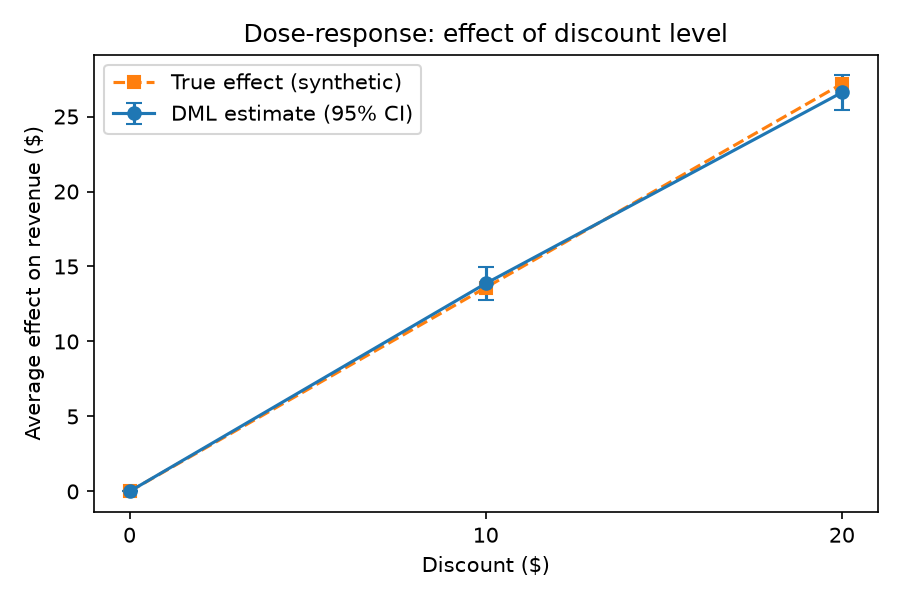
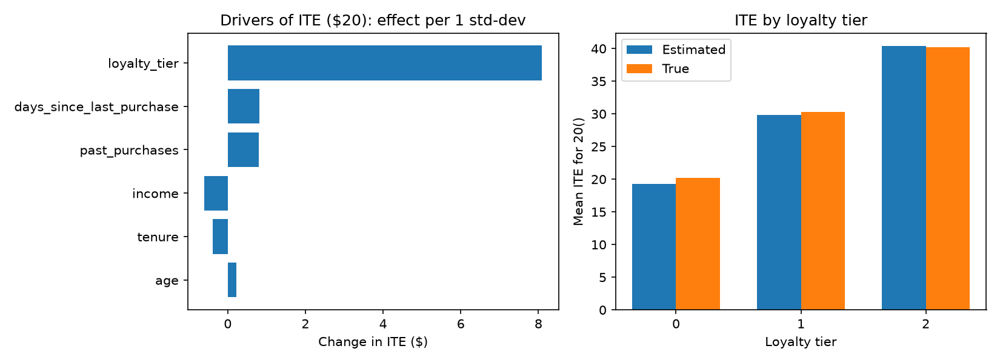

# Dose-response and heterogeneity check (20 Oct)

Model: LinearDML (cross-fitted LightGBM nuisance models). Test rows: 2000.

## 1. Dose-response ($0 / $10 / $20)

| discount | est_ate | ci_low | ci_high | true_ate | ite_rmse |
|---|---|---|---|---|---|
| 0 | 0.0 | 0.0 | 0.0 | 0.0 | 0.0 |
| 10 | 13.866 | 12.736 | 14.996 | 13.588 | 1.323 |
| 20 | 26.602 | 25.455 | 27.748 | 27.176 | 1.486 |

Sanity checks:

- ATE($20) > ATE($10) > 0: **True**
- ATE($20) / ATE($10) (truth = 2.0): **1.92**
- Extra gain of 2nd $10 (ATE20 - ATE10): **12.736**
- Share of users with ITE20 > ITE10: **1.0**
- Corr(ITE10, ITE20): **0.98**

**Interpretation (edit me):** the effect should rise with the discount. In the
synthetic data the true effect is linear in the discount ($20 = 2 x $10), so the
ratio should be close to 2 and the second $10 should add about as much as the first.

## 2. What drives the individual effect?

| feature | coef_10 | std_effect_10 | coef_20 | std_effect_20 |
|---|---|---|---|---|
| loyalty_tier | 5.0407 | 3.8562 | 10.5674 | 8.0841 |
| days_since_last_purchase | 0.0082 | 0.4324 | 0.0154 | 0.8101 |
| past_purchases | 0.2301 | 0.5098 | 0.3592 | 0.7961 |
| income | -0.0001 | -1.019 | -0.0 | -0.5979 |
| tenure | -0.168 | -0.4289 | -0.153 | -0.3906 |
| age | -0.0053 | -0.079 | 0.0151 | 0.2265 |

`std_effect_*` = change in ITE for a 1 standard-deviation increase in the feature.

### Mean ITE by loyalty tier

| loyalty_tier | est_ite_10 | true_ite_10 | est_ite_20 | true_ite_20 |
|---|---|---|---|---|
| 0 | 10.38 | 10.12 | 19.29 | 20.25 |
| 1 | 15.4 | 15.13 | 29.87 | 30.26 |
| 2 | 20.45 | 20.12 | 40.37 | 40.25 |

**Interpretation (edit me):** the data generator sets
`true_effect = 20 + 10*loyalty_tier + 0.05*past_purchases`, so loyalty_tier should
dominate, past_purchases should be tiny, and age/income/tenure/recency should be
near zero. If the DML coefficients agree, the model has recovered the true
heterogeneity. Any large coefficient on a feature with no true effect is noise.

## 3. Implication for the optimizer

Higher loyalty tiers have larger ITE, so the budget optimizer should favour them
(check this in the 21 Oct ROI policy evaluation).
